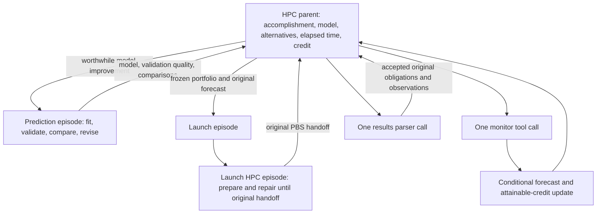

# HPC decision loops and credit

An episode is one iterative decision loop. `HPCEpisodes` adds `hpc` and
`hpc_prediction` roles to the ordinary method-loop runtime. The existing yield
controller governs continuation. An attached monitor calendar releases the
coordinator between observations; it has no model-calling or polling loop.
The existing `ExecutionServiceFactory` accepts optional `hpc_commissions` and
records/reconstructs their bindings with the normal durable workers.



Monitor or Results child episodes remain available when a real investigation
needs its own iteration. Repeated polling alone does not warrant a child.
Prediction, comparison, and choice cooperate within the parent's iteration.

## Caller commission

The caller fixes the accomplishment, permitted compromises and valuation before
the loop begins. A commission contains these operands; there are no invented
scientific rewards or automatically chosen expensive jobs.

| Field | Contract |
|---|---|
| `objective`, `resource_id` | Original accomplishment and explicit Aurora resource |
| `obligations` | Stable obligation IDs, each with `credit` and `acceptance` predicates over compact result JSON |
| `candidates` | Up to 32 useful portfolios with `id`, `queue`, integer `nodes`, integer `wall_seconds`, numerical `features`, and sequential `units` |
| Unit | `unit_id`, `obligation_id`, exact `argv`, `environment`, positive `effort`, `minimum_seconds`, `maximum_seconds`; optional `reports_progress` |
| `model.features` | Named numerical features with `identity` or `log1p` transform, positive `scale`, optional `center`; missing values get explicit indicators |
| `model.priors` | Caller priors for `queue`, `setup`, `work`, `return`, each with `median_seconds`, `log_sigma`, `coefficient_variance` |
| `model.success_prior` | Two positive Beta parameters; useful-result acceptance probability starts as a prior |
| `history` | Measured cases: unique `id`, `observed_at`, numerical `features`, `metrics`, nullable `success`, original `provenance` |
| Metric observation | `seconds` and `censored`; a failure or unfinished run does not become a successful short runtime |
| `validation_ids` | Fixed historical validation cases, excluded from training; training cases precede these in time |
| `credit` | `model_scale`, larger `validation_scale`, and fixed `validation_slots` |
| Validation slot | `id`, `metric` (`queue` or `work`), `phase` (`planned`, `queued`, `running`), `minimum_elapsed_seconds`, `weight` |
| `preferences` | `deadline_seconds`, `elapsed_cost_per_second`, `node_hour_cost` |
| `monitoring` (optional) | Explicit `min_interval_seconds`, `max_interval_seconds`, and `monitor_cost` for the attached monitor calendar |
| `limits` | `max_nodes`, `max_wall_seconds`, total `max_node_hours`, `shutdown_margin_seconds`, `result_limit_bytes`, `queue_max_age_seconds` |

Acceptance predicates have `field` (a JSON key path), `operator` (`eq`, `ge`,
`le`), and `value`. They must encode the original caller's useful result criterion,
such as a required output identity and quality threshold. Exit status zero,
successful parsing, and a file's existence alone do not establish useful work.
The caller must supply stable input/version checks within the command and result
contract when its scientific accomplishment depends on them.

Candidates should vary meaningful workload sizes, numerical parameters, resource
choices, or useful work bundles. Feature names and transforms must retain the
same meaning across historical and future work. Priors and effort estimates
are visibly uncalibrated until supported by measurements. An empty history is
allowed and earns no historical model-improvement credit.

The caller may leave `candidates` empty. The HPC episode then owns discovery and
job design: `hpc.discovery.run` performs one lightweight remote inspection or
documentation retrieval, and `hpc.candidate.propose` records an immutable candidate
within the original commission's limits. It cannot change the obligations or
their valuation. Candidate `files` contain relative paths and exact text;
`preparation` tells Launch what software and inputs to obtain. The placeholder
`{allocation_workspace}` expands when a plan is frozen. Launch receives the files,
hashes and preparation instructions directly. Scientific work belongs inside
the allocation. Discovery must not submit jobs, install software or run it.

`examples/aurora_blast_investigation.py` commissions this route with the real
model provider. It supplies an objective and connection information, leaving
database selection, worker code, setup commands and PBS choices to the episode.
HPC prompt presentation preserves the exact operational operands, including
staged file bytes; the generic scientific presentation must not hide them.
The nested Launch receives only the frozen request as its child assignment
contract. Its preparation actions do not include biological reasoning or a
timer wait; the HPC parent owns queue and execution waits after the handoff.

New example commissions explicitly attach the monitor controller described
below. Existing runs retain their original commissions and completed-action
estimates on replay, including the older model-selected timer-only waits.

Configuration uses the existing factory:

```python
factory = ExecutionServiceFactory(
    resources=aurora_resources, initial_information=recorded_inventory,
    handoff_unit=launch_unit, acquired_record_unit=acquisition_unit,
    monitoring_information_unit=monitor_information_unit,
    hpc_commissions={"useful-work": original_commission},
)
```

Pass this factory and its `as_record()` through `run_workflow`'s existing
`episode_service_factory` and `episode_service_binding`, with
`episode_service_inputs="actual_tool_registry_v1"`. An ordinary parent can then
commission role `hpc` with assignment `{"commission_id": "useful-work"}`.
If entry roles are restricted, include `hpc` in `annotation_child_roles`.
The prediction child's assignment also names its actual `owner_episode_id`.
It shares the original parent's durable ledger and cannot expand its scope.

## Information and decisions

1. `hpc.queue.observe` obtains one actual PBS job snapshot, one queue snapshot,
   and one ALCF activity snapshot, sequentially. It saves normalized fields,
   source hashes, timestamps and acquisition failures.
2. The parent can commission `hpc_prediction`. Its `hpc.model.fit` calculates a
   Bayesian regression of `log(1 + seconds)`, including coefficient uncertainty,
   measurement noise and moment updates for right-censored cases. It reports
   fixed temporal-validation quality, observation support and extrapolation.
   `hpc.compare` compares caller-approved portfolios without launching one.
3. `hpc.plan` freezes the selected portfolio, original forecast and reference
   forecast. It checks current queue limits and the original node-hour budget.
   Its output includes exact launch assignment, PBS arguments, standalone runner
   bytes, manifest bytes and file hashes. The binding also passes these bytes to
   the nested Launch contexts, so preparation is not dependent on copying a
   conversational explanation.
4. Existing Launch iterations create the project directory, stage and verify
   those bytes, and submit through the original reuse-only SSH route. The exact
   plan reserves one launch commission. Its received original handoff is attached
   with `hpc.handoff`; a changed request or second launch commission is rejected.
5. `hpc.monitor` observes that exact physical attempt, reads its allocation
   progress, optionally refreshes queue features, and immediately updates forecasts
   and attainable credit. It contains no polling loop. The parent chooses the
   next event or elapsed threshold where another observation could change its
   decision. It may improve the model, revise pending work, wait, or parse results.
6. `hpc.results` acquires bounded result bytes, verifies their hashes against the
   original unit receipts, checks original acceptance predicates and credits each
   obligation once. The actual result bytes and custody are published as ordinary
   Store Sources for the upstream parent. Completed allocations become measured
   history for later prediction iterations, one case per allocation rather than
   one case per poll.

## Queue operands

The live [ALCF activity data](https://status.alcf.anl.gov/aurora/activity.json)
contains computed scheduling `score`; this is different from PBS `Priority`.
The parser joins scores by exact PBS job ID, suppresses stale scores and reports
unknown values honestly. Before submission there is no actual target-job score.

Directly usable features include same-queue counts, similar node/walltime job
counts, higher-score and tied-score counts, unknown-score counts, queued and
higher-score node-hours, running nodes, queue assigned-node count and cap,
requested endings within 15/60 minutes, active/upcoming reserved nodes, time to
the next reservation, estimated start when exposed, and queue constraints.
"Similar" currently means within a factor of two in node count and walltime.
Held/waiting jobs are counted separately. These are resource-pressure predictors,
not a claim of dispatch order or guaranteed start time. Aurora's
[scheduling policy](https://docs.alcf.anl.gov/policies/queue-scheduling/) also
depends on project balance/type, size, duration and reservations; the
[running-jobs guide](https://docs.alcf.anl.gov/aurora/running-jobs-aurora/)
documents routing and execution queues. Version one requires a concrete observed
execution queue when planning, rather than guessing a routing destination.

For a read-only inspection, run `tools/hpc_queue_snapshot.py` through
`tools/one_workflow.sh` with either `--live` or `--recorded-directory`, plus
`--queue`, `--nodes`, `--wall-seconds`, and `--output runs/<run>/summary.json`.
`--job-id` enables actual relative-score features. Historical replay is labeled
explicitly. This command cannot submit work.

## Updates during monitoring

Queued predictions condition on having already waited the observed time.
Refreshed queue pressure can revise the underlying queue distribution. Running
predictions use elapsed time, completed effort, recent measured progress rate,
phase transitions, optional tool-written progress, progress age, resource
pressure and remaining allocation time. They expose remaining-time intervals,
overrun probability, failure probability, resource alarms and expected credit
still attainable by the pending portfolio. A memory alarm is not presented as
a calibrated failure probability.

A unit declaring `reports_progress=true` may atomically publish `progress.json`
in its own work directory with `plan_id`, `unit_id`, `observed_at` (Unix seconds),
`completed_fraction`, optional `phase` and `peak_memory_bytes`. The runner supplies
`HPC_PLAN_ID`, `HPC_UNIT_ID`, and `HPC_UNIT_DIRECTORY`. Missing/malformed progress
is recorded as unavailable; elapsed time alone is not evidence of productive work.

The original forecast is immutable. Each revision is a new timestamped record;
only forecasts issued before a later measured event can receive validation
credit. Repeated samples recompute from the frozen original rather than treating
the same progress as independent evidence repeatedly.

## Allocation use

The runner requires an actual PBS allocation and project storage. It executes
approved units sequentially in fresh per-unit directories, each with confined
temporary/cache paths and separate stdout/stderr. Commands must write compact
`result.json` there. MPI placement is part of the caller's explicit command;
the runner does not invent ranks or node utilization.

`hpc.allocation.order` can reorder remaining units from the original manifest
at unit boundaries. Version one retains all unstarted approved units; changing
the workload itself needs a new plan after the current allocation closes. This
keeps the forecast's original work obligation intact. It cannot insert arbitrary
new commands. The runner
checks remaining walltime before beginning a unit, enforces its maximum duration,
and retains shutdown time. If useful approved work is exhausted, it exits rather
than holding an idle allocation. Plans should supply enough worthwhile work to
use the intended allocation. It does not assume every campaign needs the same
allocation length.

One open allocation is allowed per HPC parent, and the full requested node-hours
are conservatively charged against the commission budget. The window's existing
bounded launcher remains responsible for one workflow per Codex window. No
global lock is added. Unknown submissions and interrupted unit intents are not
automatically repeated. Recovery continues the original launch/attempt; it does
not create a replacement allocation.

## Active work, scheduled observation, and stopping

The continuation decision separates active action yield from pending result
value. Credit already expected from a submitted job is not evidence that another
planning or prediction action will help. Completed results, monitoring and waits
are excluded from the active-action yield fit; their signed credit remains in
the original full history and ledger.

| Evidence at the decision | Controller behavior |
|---|---|
| Active marginal-gain upper bound exceeds continuation cost | Keep useful active actions available |
| Active gain is below cost, pending net value exceeds cost | Park on the attached monitor calendar, or collect terminal results |
| Both active gain and pending net value are below cost | End this decision loop |
| Active gain cannot yet be estimated | Report `active_yield_unknown`; missing evidence does not establish exhaustion |

A concrete exhaustion certificate also sets active gain to zero: every remaining
obligation is covered by pending work, the portfolio has a single fixed unit
(there is nothing to reorder), and no new measured training cases are available.
Accepted original obligations close the accomplishment loop. New observations
can invalidate an exhaustion certificate and reopen useful active work.

`HPCContinuationEstimator` supplies these separate quantities and the activity
mode to the existing yield controller. When the mode is waiting or collecting,
the next generated action schema allows only the corresponding monitor or
results tool. A positive pending value therefore cannot justify unrelated
active actions. Historical actions replay against their original contracts.

At `hpc.handoff`, a commission's explicit `monitoring` policy attaches one durable
controller to the original plan and PBS job. `hpc.monitor.wait` freezes a schedule
containing that job, the forecast reference, valuation alternatives, due time,
and the exact `hpc.monitor` wake action. It compares candidate times from the
conditional queue/work distribution within the policy's interval bounds:

`observation value(t) = P(phase change by t) * expected remaining credit - incremental cost(t)`.

Incremental cost includes the explicit monitor cost, elapsed-time price, and
running node-time price. Pending continuation value is predicted remaining
accomplishment credit less that cost. The timing comparison is an approximation
to observation value, not a calibrated full value-of-information calculation.
An expired deadline or exhausted pending value does not authorize another timed
wait. Terminal outputs retain an unresolved acceptance bound until parsing;
completion itself does not earn useful-work credit.

A wait longer than 45 seconds checkpoints that selected tool action and closes
the provider. The driver registers an idempotent **systemd calendar timer** (the
cron controller backend, not a Unix crontab entry). On wake, the same action
observes the same job exactly once and updates its forecast. It does not first
ask the model whether to choose another wait. Waiting and waking earn zero
credit; only original accepted results and eligible prospective validation
change the credit ledger. The example policy permits intervals from 60 to 1800
seconds with monitor cost 0.001 credit units; these are explicit policy operands.

`scheduled-resume.json` and `monitor-scheduler/` retain the timer registration.
The timer resumes through `tools/one_workflow.sh` with the original
`CODEX_THREAD_ID`. It neither retries authentication nor replaces the original
submission. A busy window prevents that invocation from starting; the current
backend records failure rather than retrying it automatically. Durable retry
after a busy window remains future work.

Multiple simultaneous allocations are not implemented in this version. Their
decision rule must value an additional launch or prediction action by its
incremental contribution **given the jobs already pending**, including overlap
between their expected results. Portfolio pending value must deduplicate original
obligations rather than sum each job's full reward. Once all available active
actions are below cost, the parent parks until the earliest worthwhile job event;
that event updates the portfolio and reopens the decision. The current one-open-
allocation restriction remains explicit rather than pretending this aggregation
already exists.

For that extension, each available action needs a recorded marginal forecast:

`gain(a | pending) = E[useful-work + validation credit | pending, a] - E[useful-work + validation credit | pending, wait] - added cost(a)`.

The forecast must identify the additional obligations or decisions it can
improve, its evidence and uncertainty, and the later observation that can settle
it. Prediction refinement can have value through better job selection or
prospective calibration; rewriting a forecast alone earns nothing. Submission
has value only for its additional expected outcome. A portfolio-wide exhaustion
decision requires every available action's supported upper bound to be below
the threshold, or a concrete exhaustion certificate. The present active-history
fit is the first implementation of this distinction, not yet that full action-
conditional portfolio model.

## Credit and durability

The parent's signed cumulative credit is:

`accepted original work + alpha * (Q(model) - Q(reference)) + prospective validation`.

`Q` is mean proper log predictive score on the fixed disjoint temporal cases,
including measured success/failure. There is no fitting-residual reward. Models
trained on later real allocations do not reuse that earlier validation set for
credit; their improvement is tested prospectively. The prediction child receives
only measured model improvement relative to its own entry model.

Each original prospective slot pays
`beta * weight * (log_score(frozen prediction, outcome) - log_score(reference, outcome))`.
The first eligible forecast reserves the slot. The caller fixes the number,
weights, metric and observation phase beforehand; extra jobs, polls, files or
forecast revisions cannot add slots. Right-censored observations use survival
scores. A later finish replaces the interim censored score rather than adding
another reward. Negative corrections are retained. Launch and optional monitor
child credits are not summed into the parent's useful-work credit.

The per-parent SQLite ledger retains original commission, action selections,
models, plans, forecasts, native observations, result bytes/custody and score
evidence. Immutable conflicts fail closed. Completed action replay and committed
observation steps do not reacquire evidence. Result obligations and validation
slots are deduplicated by original identity, not number of attempts.

## Verification and remaining live work

`tests/test_hpc_episode_design.py` exercises probability/censoring, temporal
validation, immutable forecasts, signed score replacement, original-work
deduplication, restart recovery, real binding/factory registration, actual launch
schemas and preparation handoff. Parser inputs are selected real Aurora records
in `tests/fixtures/hpc/`. There is no fake SSH service or fabricated PBS run.

`tests/test_hpc_monitoring.py` checks original Source custody, frozen monitor
identity and wake specification, active-versus-pending valuation, zero earned
sleep credit, and compatibility with completed pre-controller observations.

These checks do not establish live allocation behavior or forecast calibration.
The first useful-work allocation must test launch, monitoring revisions, unit
selection at boundaries, result custody and observed-vs-predicted timing together.
Portfolio value currently uses effort fractions and median overhead, an explicit
approximation that does not model all timing/quality correlations. The predictor
has bounded historical input (2,000 cases, 24 named features), reports unsupported
regions, and needs actual measured history to improve beyond caller priors.
