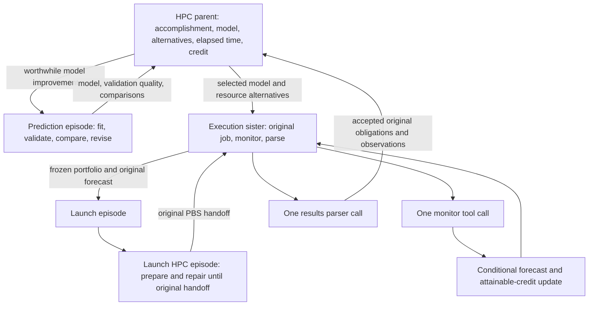

# HPC decision loops and credit

An episode is one iterative decision loop. `HPCEpisodes` adds `hpc`,
`hpc_prediction`, and `hpc_execution` roles to the ordinary method-loop runtime. The existing yield
controller governs continuation. An attached monitor calendar releases the
coordinator between observations; it has no model-calling or polling loop.
The existing `ExecutionServiceFactory` accepts optional `hpc_commissions` and
records/reconstructs their bindings with the normal durable workers.

For investigations that freeze work after startup, an explicit
`hpc_commissions={}` enables received commissions with a configured PBS
resource. `None` leaves this service disabled. With an empty initial catalog,
assignments require an actually received `commission_source_ref` issued by
`hpc_commission_sources`; scope/resource checks and the HPC parent/sister
ownership rules still apply. No static bootstrap job is needed. This startup
extension was added during A107/A110 source integration on 2026-11-05; its
workflow validation remains deferred.



Monitor or Results child episodes remain available when a real investigation
needs its own iteration. Repeated polling alone does not warrant a child.
Prediction, comparison, and choice cooperate within the parent's iteration.
Prediction and execution are sister iterations under that parent, sharing its
original commission and ledger. The execution sister owns Launch, monitoring,
and parsing. Existing callers can still use the parent's direct execution tools.

## Caller commission

The caller fixes the accomplishment, permitted compromises and valuation before
the loop begins. A commission contains these operands; there are no invented
scientific rewards or automatically chosen expensive jobs.

| Field | Contract |
|---|---|
| `objective`, `resource_id` | Original accomplishment and explicit Aurora resource |
| `obligations` | Stable obligation IDs, each with `credit` and `acceptance` predicates over compact result JSON |
| `candidates` | Useful portfolios with `id`, `queue`, integer `nodes`, integer `wall_seconds` for the PBS allocation request, numerical `features`, and sequential `units` |
| Unit | `unit_id`, `obligation_id`, exact `argv`, `environment`, positive `effort`; optional `reports_progress`; no runtime cutoff |
| `model.features` | Named numerical features with `identity` or `log1p` transform, positive `scale`, optional `center`; missing values get explicit indicators |
| `model.priors` | Caller priors for `queue`, `setup`, `work`, `return`, each with `median_seconds`, `log_sigma`, `coefficient_variance` |
| `model.resource_priors` (optional) | `cpu_seconds` and `memory_bytes` distributions with explicit `median`, `unit`, `log_sigma`, `coefficient_variance` |
| Candidate `resource_capacity` (optional) | Observed allocation `cpu_threads` and `memory_bytes`; used in comparisons, never an application termination timer |
| `model.success_prior` | Two positive Beta parameters; useful-result acceptance probability starts as a prior |
| `history` | Measured cases: unique `id`, `observed_at`, numerical `features`, `metrics`, nullable `success`, original `provenance` |
| Metric observation | `seconds` and `censored`; a failure or unfinished run does not become a successful short runtime |
| Resource observation | `value`, `unit`, `censored`, original source and measurement scope; allocated cores are never substituted for observed CPU time |
| `validation_ids` | Fixed historical validation cases, excluded from training; training cases precede these in time |
| `credit` | `model_scale`, larger `validation_scale`, and fixed `validation_slots` |
| Validation slot | `id`, `metric` (`queue`, `work`, `cpu_seconds`, or `memory_bytes`), `phase` (`planned`, `queued`, `running`), `minimum_elapsed_seconds`, `weight` |
| `preferences` | `elapsed_cost_per_second`, `node_hour_cost`; these inform credit decisions |
| `monitoring` (optional) | Explicit `min_interval_seconds`, `max_interval_seconds`, and `monitor_cost` for the attached monitor calendar |
| `limits` | `result_limit_bytes` for memory-safe collection, `queue_max_age_seconds` for observation freshness |

There is no application run deadline, work-unit timeout, or cumulative usage
budget. The runner waits for each native command to return. PBS allocation
duration describes the scheduler resource request and informs forecasts; the
application does not install a second timer or kill work when a prediction is
exceeded. Monitor wake times and credit-based continuation decisions remain.

Acceptance predicates have `field` (a JSON key path), `operator` (`eq`, `ge`,
`le`), and `value`. They must encode the original caller's useful result criterion,
such as a required output identity and quality threshold. Exit status zero,
successful parsing, and a file's existence alone do not establish useful work.
The caller must supply stable input/version checks within the command and result
contract when its scientific accomplishment depends on them.

Candidates should vary meaningful workload sizes, numerical parameters, resource
choices, or useful work bundles. Feature names and transforms must retain the
same meaning across historical and future work. Priors and effort estimates
are visibly uncalibrated until supported by measurements. An empty history is
allowed and earns no historical model-improvement credit.

The caller may leave `candidates` empty. The HPC episode then owns discovery and
job design: `hpc.discovery.run` performs one lightweight remote inspection or
documentation retrieval, and `hpc.candidate.propose` records an immutable candidate
within the original commission's limits. It cannot change the obligations or
their valuation. Candidate `files` contain relative paths and exact text;
`preparation` tells Launch what software and inputs to obtain. The placeholder
`{allocation_workspace}` expands when a plan is frozen. Launch receives the files,
hashes and preparation instructions directly. Scientific work belongs inside
the allocation. Discovery must not submit jobs, install software or run it.

`examples/aurora_blast_investigation.py` commissions this route with the real
model provider. It supplies an objective and connection information, leaving
database selection, worker code, setup commands and PBS choices to the episode.
HPC prompt presentation preserves the exact operational operands, including
staged file bytes; the generic scientific presentation must not hide them.
The nested Launch receives the frozen scientific request, result requirements
and resource constraints as its child assignment. It chooses scripts,
environment preparation and native commands through ordinary `exec_command`
actions. Each returned command outcome enters the original episode iterator.
The host retains command, submitted-script and native-job provenance. The HPC
parent owns queue and execution waits after the original handoff.

Resource configuration selects the execution agent's prompt from the run-frozen
launch instruction library. `launch_prompt_entry` names an entry;
`launch_prompt_sections` optionally selects exact section IDs (all entry
sections are supplied when omitted). The host delivers those sections directly
as `resource_launch_instructions`; the agent need not perform a lookup to obtain
its assigned resource instructions. Aurora uses `launch-aurora` and
`scheduler: {"kind": "pbs", "required_resources": ["filesystems=flare"]}` for
transparent observation of actual selected native scheduler commands and its
required filesystem resource. Another cluster supplies its own instruction entry
and resource configuration while retaining the same Launch episode and general
execution tool. Resource prompts do not provide a fixed sequence of operations.

New example commissions explicitly attach the monitor controller described
below. Retained runs keep their original commissions and completed-action
estimates. Import their measurements with the read-only history importer;
new execution configurations reject the retired hard-stop settings.

Configuration uses the existing factory:

```python
factory = ExecutionServiceFactory(
    resources=aurora_resources, initial_information=recorded_inventory,
    handoff_unit=launch_unit, acquired_record_unit=acquisition_unit,
    monitoring_information_unit=monitor_information_unit,
    hpc_commissions={"useful-work": original_commission},
    shared_execution_memory=ExecutionMemory.configured().as_record(),
)
```

Pass this factory and its `as_record()` through `run_workflow`'s existing
`episode_service_factory` and `episode_service_binding`, with
`episode_service_inputs="actual_tool_registry_v1"`. An ordinary parent can then
commission role `hpc` with assignment `{"commission_id": "useful-work"}`.
If entry roles are restricted, include `hpc` in `annotation_child_roles`.
`ExecutionMemory` comes from `gene_annotation_episode.execution_memory`; see
[A101 execution planning](A101_EXECUTION_PLANNING.md) for catalog-wide recipes,
shared history, forgetting and detached local execution.

Both sisters' assignments name the actual hpc parent's `owner_episode_id` and
`commission_id`. They share its durable ledger and cannot expand its scope.
The prediction sister can inspect missing resource and queue facts and propose
executable portfolios, then records its model and comparisons. It cannot launch
or collect a job. The execution
sister uses those exact identities. Original forecasts retain the predicting
episode identity so later validation credit is attributable to its model.

`examples/aurora_resource_prediction_investigation.py` exercises this path with
the real model provider and original closed SHA-256 PBS ledgers. The caller
supplies historical measurements and a calibration objective; the episodes
design worker counts, candidates, launcher affinity and executable files.
The driver does not script their choices or supply scheduler replies.
Repeat `--history-ledger` to supply distinct original allocations. A failed
result contract remains a failed outcome even when PBS measured useful CPU and
memory data; importing those measurements does not accept the missing result.
Its optional `--minimum-iterations` specifies the useful calibration workload
for a new commission; it does not limit episode runtime.
`--elapsed-cost-per-second` supplies the caller's valuation of delay and affects
the monitor's observation-time comparison. It installs no termination timer.
Resumes retain the original commission unchanged.

Resource forecasts use PBS-reported CPU seconds and memory bytes with their
measurement scope retained. CPU seconds divided by work seconds is an approximate
average occupied-core estimate, not peak thread concurrency. GPU demand and
unobserved utilization remain unknown. Candidate worker threads, allocated nodes
and measured utilization are distinct. Memory capacity affects expected feasible
credit probabilistically; missing capacity stays unknown and no execution gate
is introduced. CPU and memory observations enter shared history with compatible
profiles and forgetting weights, just like timing observations.

Feature transforms must normalize large quantities such as bytes and iteration
counts. Collecting queue fields is insufficient: the model feature specification
must include congestion/score fields if those observations are to affect it.
An untrained model and one historical measurement are not evidence of calibration.

## Information and decisions

1. `hpc.queue.observe` obtains one actual PBS job snapshot, one queue snapshot,
   and one ALCF activity snapshot, sequentially. It saves normalized fields,
   source hashes, timestamps and acquisition failures.
2. The parent can commission `hpc_prediction`. Its `hpc.model.fit` calculates a
   Bayesian regression of `log(1 + seconds)`, including coefficient uncertainty,
   measurement noise and moment updates for right-censored cases. It reports
   fixed temporal-validation quality, observation support and extrapolation.
   `hpc.compare` compares caller-approved portfolios without launching one.
3. `hpc.plan` freezes the selected portfolio, original forecast and reference
   forecast. It checks the scheduler's current queue resource constraints.
   Its output includes exact launch assignment, PBS arguments, standalone runner
   bytes, manifest bytes and file hashes. The binding also passes these bytes to
   the nested Launch contexts, so preparation is not dependent on copying a
   conversational explanation.
4. Launch chooses the scripts, environment and commands needed to execute the
   frozen scientific job through the original reuse-only SSH route. Supplied
   input bytes and scientific output contracts remain authoritative. The host
   records the selected commands, actual submitted script and native job ID;
   a submission-command failure does not imply scheduler rejection. The exact
   plan reserves one launch commission. Its received original handoff is attached
   with `hpc.handoff`; a changed request or second launch commission is rejected.
   `hpc_launch_report_form` carries source-bound handoff references across the
   parent boundary. If a completed return omitted them, `redeliver_report`
   uses its existing delivery; it does not submit work. A repeated nested Launch
   for the exact frozen assignment recovers the original committed native
   receipt and observes that job. Ownership, scope and assignment must match.
5. `hpc.monitor` observes that exact physical attempt, reads its allocation
   progress, optionally refreshes queue features, and immediately updates forecasts
   and attainable credit. It contains no polling loop. The parent chooses the
   next event or elapsed threshold where another observation could change its
   decision. It may improve the model, revise pending work, wait, or parse results.
   The first `hpc.monitor.wait` establishes an actual post-submission observation
   before choosing its calendar time. A job already known to be terminal proceeds
   to collection; this is not recorded as a calendar wake.
6. `hpc.results` acquires bounded result bytes, verifies their hashes against the
   original unit receipts, checks original acceptance predicates and credits each
   obligation once. The actual result bytes and custody are published as ordinary
   Store Sources for the upstream parent. Completed allocations become measured
   history for later prediction iterations, one case per allocation rather than
   one case per poll.

## Queue operands

The live [ALCF activity data](https://status.alcf.anl.gov/aurora/activity.json)
contains computed scheduling `score`; this is different from PBS `Priority`.
The parser joins scores by exact PBS job ID, suppresses stale scores and reports
unknown values honestly. Before submission there is no actual target-job score.

Directly usable features include same-queue counts, similar node/walltime job
counts, higher-score and tied-score counts, unknown-score counts, queued and
higher-score node-hours, running nodes, queue assigned-node count and cap,
requested endings within 15/60 minutes, active/upcoming reserved nodes, time to
the next reservation, estimated start when exposed, and queue constraints.
"Similar" currently means within a factor of two in node count and walltime.
Held/waiting jobs are counted separately. These are resource-pressure predictors,
not a claim of dispatch order or guaranteed start time. Aurora's
[scheduling policy](https://docs.alcf.anl.gov/policies/queue-scheduling/) also
depends on project balance/type, size, duration and reservations; the
[running-jobs guide](https://docs.alcf.anl.gov/aurora/running-jobs-aurora/)
documents routing and execution queues. Version one requires a concrete observed
execution queue when planning, rather than guessing a routing destination.

For a read-only inspection, run `tools/hpc_queue_snapshot.py` through
`tools/one_workflow.sh` with either `--live` or `--recorded-directory`, plus
`--queue`, `--nodes`, `--wall-seconds`, and `--output runs/<run>/summary.json`.
`--job-id` enables actual relative-score features. Historical replay is labeled
explicitly. This command cannot submit work.

## Updates during monitoring

Queued predictions condition on having already waited the observed time.
Refreshed queue pressure can revise the underlying queue distribution. Running
predictions use elapsed time, completed effort, recent measured progress rate,
phase transitions, optional tool-written progress, progress age, resource
pressure and remaining allocation time. They expose remaining-time intervals,
overrun probability, failure probability, resource alarms and expected credit
still attainable by the pending portfolio. A memory alarm is not presented as
a calibrated failure probability.

A unit declaring `reports_progress=true` may atomically publish `progress.json`
in its own work directory with `plan_id`, `unit_id`, `observed_at` (Unix seconds),
`completed_fraction`, optional `phase` and `peak_memory_bytes`. The runner supplies
`HPC_PLAN_ID`, `HPC_UNIT_ID`, and `HPC_UNIT_DIRECTORY`. Missing/malformed progress
is recorded as unavailable; elapsed time alone is not evidence of productive work.
Retained progress using the environment-variable spellings as JSON keys is
normalized only when its plan/unit identities agree; raw evidence is preserved.

The original forecast is immutable. Each revision is a new timestamped record;
only forecasts issued before a later measured event can receive validation
credit. Repeated samples recompute from the frozen original rather than treating
the same progress as independent evidence repeatedly.
CPU-time and memory forecasts condition on usage already observed. Their final
validation uses original PBS accounting values and explicit units. A caller's
historical case and its shared-memory copy cannot count as two physical jobs.

## Allocation use

The runner requires an actual PBS allocation and project storage. It executes
approved units sequentially in fresh per-unit directories, each with confined
temporary/cache paths and separate stdout/stderr. Commands must write compact
`result.json` there. Workers should construct both output paths from
`os.environ["HPC_UNIT_DIRECTORY"]`; `{allocation_workspace}` names staged inputs,
not unit output. The runner freezes the result hash at native completion.
A result written elsewhere does not satisfy that receipt and is reported as
`missing_original_result_receipt`, even if later discovery finds valid JSON.
MPI placement is part of the caller's explicit command; the runner does not
invent ranks or node utilization.

`hpc.allocation.order` can reorder remaining units from the original manifest
at unit boundaries. Version one retains all unstarted approved units; changing
the workload itself needs a new plan. This
keeps the forecast's original work obligation intact. It cannot insert arbitrary
new commands. The runner waits for native completion without an application
termination timer. If useful approved work is exhausted, it exits rather
than holding an idle allocation. Plans should supply enough worthwhile work to
use the intended allocation. It does not assume every campaign needs the same
allocation length.

Multiple allocations retain separate original job identities and monitor owners.
Pending value is deduplicated by the original accomplishment obligation; a second
allocation cannot multiply its expected reward. Requested node-hours inform cost
predictions without a cumulative stopping budget. The window's existing launcher
remains responsible for one workflow per Codex window and machine protection. No
global workflow lock is added. Unknown submissions and interrupted unit intents are not
automatically repeated. Recovery continues the original launch/attempt; it does
not create a replacement allocation.

## Active work, scheduled observation, and stopping

The continuation decision separates active action yield from pending result
value. Credit already expected from a submitted job is not evidence that another
planning or prediction action will help. Completed results, monitoring and waits
are excluded from the active-action yield fit; their signed credit remains in
the original full history and ledger.

| Evidence at the decision | Controller behavior |
|---|---|
| Active marginal-gain upper bound exceeds continuation cost | Keep useful active actions available |
| Active gain is below cost, pending net value exceeds cost | Park on the attached monitor calendar, or collect terminal results |
| Both active gain and pending net value are below cost | End this decision loop |
| Active gain cannot yet be estimated | Report `active_yield_unknown`; missing evidence does not establish exhaustion |

A concrete exhaustion certificate also sets active gain to zero: every remaining
obligation is covered by pending work, the portfolio has a single fixed unit
(there is nothing to reorder), and no new measured training cases are available.
Accepted original obligations close the accomplishment loop. New observations
can invalidate an exhaustion certificate and reopen useful active work.

The prediction sister has its own evidence-based completion case: all available
distinct measurements have been fitted, every current candidate has a comparison
under that model and a fresh queue observation, and there is no held-out evidence
to support further model-improvement credit. Its supported additional action
value is then zero and it returns to the parent. New measurements/candidates or
stale queue information invalidate that case. No action-count or elapsed-time
limit is involved, and fitting/comparing alone does not earn credit.

`HPCContinuationEstimator` supplies these separate quantities and the activity
mode to the existing yield controller. Waiting and collecting modes recommend
the corresponding monitor or results tool; they do not remove other actions or
add an execution gate. Positive pending value remains separate from evidence
about the yield of active work. Historical actions retain their original contracts.

At `hpc.handoff`, a commission's explicit `monitoring` policy attaches one durable
controller to the original plan and PBS job. `hpc.monitor.wait` freezes a schedule
containing that job, the forecast reference, valuation alternatives, due time,
and the exact `hpc.monitor` wake action. It compares candidate times from the
conditional queue/work distribution within the policy's interval bounds:

`observation value(t) = P(phase change by t) * expected remaining credit - incremental cost(t)`.

Incremental cost includes the explicit monitor cost, elapsed-time price, and
running node-time price. Pending continuation value is predicted remaining
accomplishment credit less that cost. The timing comparison is an approximation
to observation value, not a calibrated full value-of-information calculation.
Exhausted pending value does not authorize another timed wait. Terminal outputs
retain an unresolved acceptance bound until parsing;
completion itself does not earn useful-work credit.

The current shared runtime retains the selected monitor action and its owning
episode during the scheduled external wait. It signals suspension through live
invocation boundaries so an ancestor with eligible work can use its own iterator.
Ordinary child execution remains awaited until completion or an actual external
wait. The timer resumes the same selected monitor action against the same job;
there is no delay threshold that unwinds the episode into its launcher. Internal
suspension and wake events create no credit observation. The actual monitor
result is assessed at the original action boundary. A separately model-selected
wait retains its own measured observation, including zero when it delivered no
progress. The example policy permits intervals from 60 to 1800 seconds with
monitor cost 0.001 credit units; these remain explicit policy operands.

Earlier executed examples retained timer registrations in `scheduled-resume.json`
and `monitor-scheduler/`. That historical driver resumed through
`tools/one_workflow.sh` with the original
`CODEX_THREAD_ID`. That driver did not retry authentication or replace the original
submission. A busy window prevented its invocation from starting and recorded
failure. Maintained callers now use the shared suspension described above;
these historical timer files do not define the current episode lifecycle.

The ledger and pending-value calculation support multiple original allocations;
live orchestration of concurrent allocations remains unverified. The decision
rule must value an additional launch or prediction action by its
incremental contribution **given the jobs already pending**, including overlap
between their expected results. Portfolio pending value must deduplicate original
obligations rather than sum each job's full reward. Once all available active
actions are below cost, the parent parks until the earliest worthwhile job event;
that event updates the portfolio and reopens the decision.

For that extension, each available action needs a recorded marginal forecast:

`gain(a | pending) = E[useful-work + validation credit | pending, a] - E[useful-work + validation credit | pending, wait] - added cost(a)`.

The forecast must identify the additional obligations or decisions it can
improve, its evidence and uncertainty, and the later observation that can settle
it. Prediction refinement can have value through better job selection or
prospective calibration; rewriting a forecast alone earns nothing. Submission
has value only for its additional expected outcome. A portfolio-wide exhaustion
decision requires every available action's supported upper bound to be below
the threshold, or a concrete exhaustion certificate. The present active-history
fit is the first implementation of this distinction, not yet that full action-
conditional portfolio model.

## Credit and durability

The parent's signed cumulative credit is:

`accepted original work + alpha * (Q(model) - Q(reference)) + prospective validation`.

`Q` is mean proper log predictive score on the fixed disjoint temporal cases,
including measured success/failure. There is no fitting-residual reward. Models
trained on later real allocations do not reuse that earlier validation set for
credit; their improvement is tested prospectively. The prediction child receives
only measured model improvement relative to its own entry model.

Each original prospective slot pays
`beta * weight * (log_score(frozen prediction, outcome) - log_score(reference, outcome))`.
The first eligible forecast reserves the slot. The caller fixes the number,
weights, metric and observation phase beforehand; extra jobs, polls, files or
forecast revisions cannot add slots. Right-censored observations use survival
scores. A later finish replaces the interim censored score rather than adding
another reward. Negative corrections are retained. Launch and optional monitor
child credits are not summed into the parent's useful-work credit.

The per-parent SQLite ledger retains original commission, action selections,
models, plans, forecasts, native observations, result bytes/custody and score
evidence. Immutable conflicts fail closed. Completed action replay and committed
observation steps do not reacquire evidence. Result obligations and validation
slots are deduplicated by original identity, not number of attempts.

## Verification and remaining limitations

`tests/test_hpc_episode_design.py` exercises probability/censoring, temporal
validation, immutable forecasts, signed score replacement, original-work
deduplication, restart recovery, real binding/factory registration, actual launch
schemas and preparation handoff. Parser inputs are selected real Aurora records
in `tests/fixtures/hpc/`. There is no fake SSH service or fabricated PBS run.

`tests/test_hpc_monitoring.py` checks original Source custody, frozen monitor
identity and wake specification, active-versus-pending valuation, zero earned
sleep credit, and compatibility with completed pre-controller observations.

`tests/test_hpc_resource_prediction.py` checks resource learning, unit labels,
probabilistic memory fit, conditional demand updates, physical-job deduplication,
sister attribution, retained-model recovery and evidence-based prediction-loop
completion. `tests/test_hpc_handoff_recovery.py` verifies that recovery observes
the original native receipt rather than submitting a replacement.

The real example writes `prediction-audit.json` from the retained ledger and
runtime receipts. It checks sister/model identity, resource alternatives,
actual calendar resume, a single original PBS submission, original result
acceptance, executed workload features, signed resource scoring and shared
measurement export. Forecast intervals and their observed coverage are reported
separately: passing the wiring audit does not establish calibration.

On 2026-11-04, the focused prediction, episode, handoff, monitoring and shared
history suite passed 83 tests. Live run
`runs/aurora_resource_prediction_20261104_04/prediction-audit.json` passed all
14 checks using PBS job `9039911.aurora-pbs-0001.hostmgmt.cm.aurora.alcf.anl.gov`.
The sisters compared 16 and 32 workers, chose one node with 16 workers, and
completed 4.096 billion SHA-256 iterations on compute host `x4509c3s4b0n0`.
The first monitor observed queued state; the attached calendar resumed the
original workflow, observed completion and accepted the original unit receipt.
This case did not observe an intermediate running state.

| Measurement | Frozen median | Observed PBS accounting |
|---|---:|---:|
| CPU time | 866 CPU-seconds | 1,308 CPU-seconds |
| Memory | 128 MiB | 101 MiB |

Both resource outcomes were inside their broad p10–p90 intervals. Their signed
validation credits were +0.04531 and +0.07592 respectively, attributed to the
prediction sister; accepted work earned 10, and waiting earned zero. The actual
measurement was exported to shared history. Earlier failed runs and negative
prediction scores remain in their original ledgers. Sparse observations do not
establish an optimal worker count or reliable forecasts for other algorithms.

Portfolio value currently uses effort fractions and median overhead, an explicit
approximation that does not model all timing/quality correlations. The predictor
has bounded historical input (2,000 cases, 24 named features), reports unsupported
regions, and needs actual measured history to improve beyond caller priors.
Live concurrent allocations and reordering multiple useful units within one
allocation still require their own evidence.
